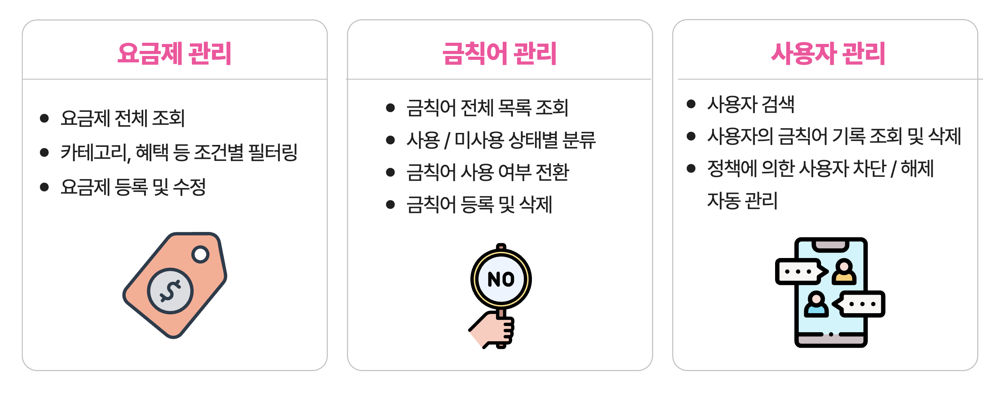
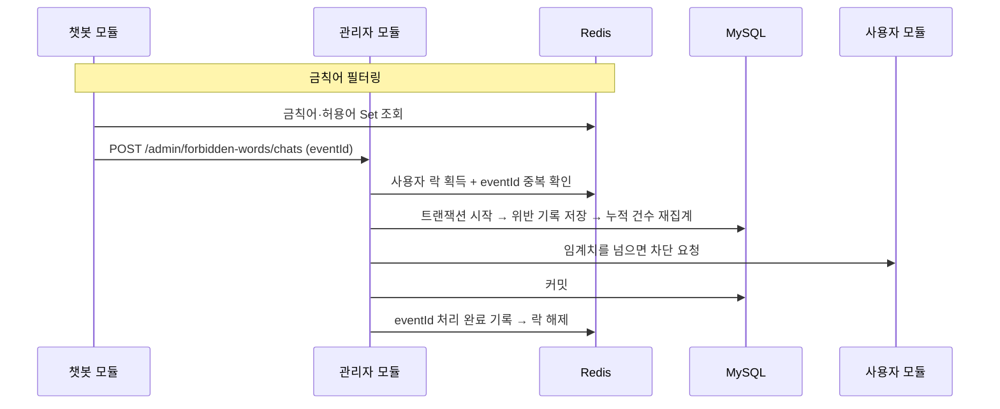

# 관리자 모듈 (Admin Backend)

> LG U+ 유레카 2기 백엔드 비대면 종합 프로젝트 **요기 U+** (최우수상) · 관리자 모듈

MSA로 구성된 요기 U+에서 관리자 기능을 담당하는 모듈입니다. 팀 프로젝트(2025.06)에서 이 모듈을 맡아 개발했고, 이후 **동시 요청과 다중 인스턴스 환경에서도 금칙어 제재가 정확하게 동작하도록** 개인적으로 고도화했습니다.

- 챗봇 모듈: [chatbot-backend-enhanced](https://github.com/mike7643/chatbot-backend-enhanced)



## 주요 기능

- 금칙어·허용어 관리: 등록, 삭제, 사용 여부 전환. 변경 사항은 Redis Set으로 챗봇 필터에 반영
- 금칙어 위반 기록: 챗봇이 감지한 위반을 저장하고 누적 횟수 집계
- 사용자 제재: 누적 횟수 임계치에 따라 사용자 모듈에 차단·해제 요청

### 금칙어 정책

한 메시지에서 금칙어 N개가 발견되면 위반 N회로 집계합니다.

| 누적 위반 | 제재 |
| ---: | --- |
| 30회 | 당일 자정까지 이용 불가 |
| 50회 | 다음 날 자정까지 |
| 100회 | 1주 후 자정까지 |
| 300회 | 2주 후 자정까지 |
| 500회 | 1개월 후 자정까지 |
| 1000회 | 영구 정지 |

위반 기록을 삭제해 누적 횟수가 임계치 아래로 내려가면 차단을 해제합니다.

## 처리 흐름



금칙어 관리 쪽은 DB 커밋 이후에만 Redis Set을 갱신하고, 5분 주기 동기화가 누락분을 보정합니다.

## 고도화

| 문제 | 해결 | 검증 |
| --- | --- | --- |
| 락이 커밋 전에 풀려 동시 요청 시 제재·해제가 중복 호출 | 락 → 트랜잭션 → 커밋 → 락 해제 순서로 재구성 | 동시성 테스트 10회 반복: 수정 전 해제 중복 10/10, 제재 중복 2/10 → 수정 후 0/10 |
| 재시도·중복 전송 시 위반 이중 집계 | eventId 멱등성, 커밋 이후에만 처리 완료 기록 | 같은 eventId 5건 동시 전송 시 1건 저장 |
| 롤백돼도 Redis에는 금칙어가 반영됨 | `@TransactionalEventListener(AFTER_COMMIT)`로 커밋 후 반영 | 커밋 시 반영 / 롤백 시 미반영 통합 테스트 |
| 주기 동기화 중 챗봇이 빈 금칙어 Set을 읽는 구간 | 키를 지우고 다시 채우는 방식을 차이만 반영하는 방식으로 변경 | 차이 보정 통합 테스트 |

모든 동시성·정합성 테스트는 Testcontainers(MySQL 8, Redis 7) 위에서 실제 트랜잭션과 Redisson 락으로 실행합니다.

### 1. 락 해제가 커밋보다 먼저 일어나는 문제 · [#4](https://github.com/mike7643/admin-backend-enhanced/pull/4)

위반 기록 처리는 `저장 → 누적 건수 재집계 → 임계치 판단` 순서이고, 같은 사용자의 요청은 Redisson 분산락으로 직렬화했습니다. 그런데 락을 서비스 메서드의 `@Transactional` **안에서** 잡고 있었습니다.

```
요청 A: [트랜잭션 시작 [락 획득 → 저장 → 집계(30) → 제재] 락 해제] ← 커밋
요청 B:                                            [락 획득 → 집계(30, A 미커밋분 안 보임) → 제재 또 호출]
```

락을 잡아도 커밋이 락 해제 뒤에 일어나면, 다음 요청은 아직 커밋되지 않은 건수를 보지 못하고(InnoDB 기본 격리 수준) 같은 임계치를 다시 넘었다고 판단합니다.

- 서비스 메서드는 `Propagation.NOT_SUPPORTED`로 두고, UseCase 안에서 락을 잡은 뒤 `TransactionTemplate`으로 트랜잭션 실행
- 사용자 모듈 호출은 트랜잭션 안에 두어, 실패하면 위반 기록도 롤백되고 같은 eventId로 다시 시도할 수 있게 함
- 사용자 모듈 호출에 3초 타임아웃: 락 임대 시간(10초) 안에 작업이 끝나도록 보장
- 일시적 실패(락 획득 실패, 사용자 모듈 장애)는 503으로 응답해 호출 측이 재시도 여부를 판단할 수 있게 함

| 시나리오 (10회 반복) | 수정 전 | 수정 후 |
| --- | --- | --- |
| 누적 30건에서 기록 2건 동시 삭제 → 해제 1회 | 10/10 실패 (2회 호출) | 10/10 통과 |
| 누적 29건에서 위반 10건 동시 등록 → 제재 1회 | 2/10 실패 (2회 호출) | 10/10 통과 |

### 2. 위반 누적 집계와 멱등성 · [#1](https://github.com/mike7643/admin-backend-enhanced/pull/1), [#2](https://github.com/mike7643/admin-backend-enhanced/pull/2)

- 저장 전 건수에 이번 건수를 더하는 추정 대신, 저장 후 실제 건수를 다시 조회해 임계치 판단
- 챗봇이 메시지 ID 기반 eventId(`chat-message:{id}`)를 보내고([chatbot#4](https://github.com/mike7643/chatbot-backend-enhanced/pull/4)), 관리자 모듈은 커밋 이후 Redis에 처리 완료를 기록
- 제재 정책(`UserModerationService`), 등록·삭제 흐름(UseCase)을 분리

### 3. DB와 Redis 금칙어 Set의 정합성 · [#3](https://github.com/mike7643/admin-backend-enhanced/pull/3)

- 서비스는 DB 변경 후 이벤트만 발행하고, `AFTER_COMMIT` 리스너가 Redis에 반영
  - 허용어 등록 메서드에 트랜잭션이 없어 리스너가 실행되지 않던 문제를 통합 테스트로 발견해 수정
- 리스너가 실패하면 로그를 남기고, 5분 주기 `RedisSynchronizer`가 DB 기준으로 보정
  - `DEL` 후 재적재 대신 차이만 반영해, 동기화 순간 챗봇이 빈 Set을 읽지 않도록 함
  - 반영 직전에 대상 단어를 DB에서 다시 조회해, 동기화 도중 커밋된 변경을 되돌리지 않도록 함

## 기술 스택

| 구분 | 기술 |
| --- | --- |
| 언어·프레임워크 | Java 17, Spring Boot 3.5 |
| 데이터 | Spring Data JPA, MySQL 8 |
| 캐시·락 | Spring Data Redis, Redisson |
| 모듈 간 통신 | Spring WebClient |
| 테스트 | JUnit 5, Mockito, Testcontainers (MySQL, Redis) |

## 테스트 실행

Docker가 실행 중이어야 합니다.

```bash
./gradlew test
```
